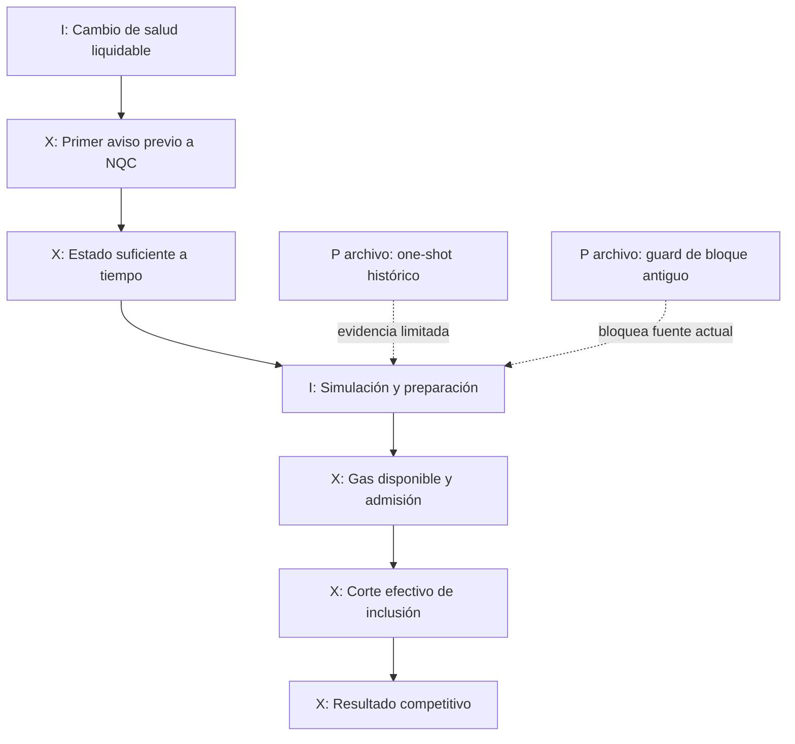
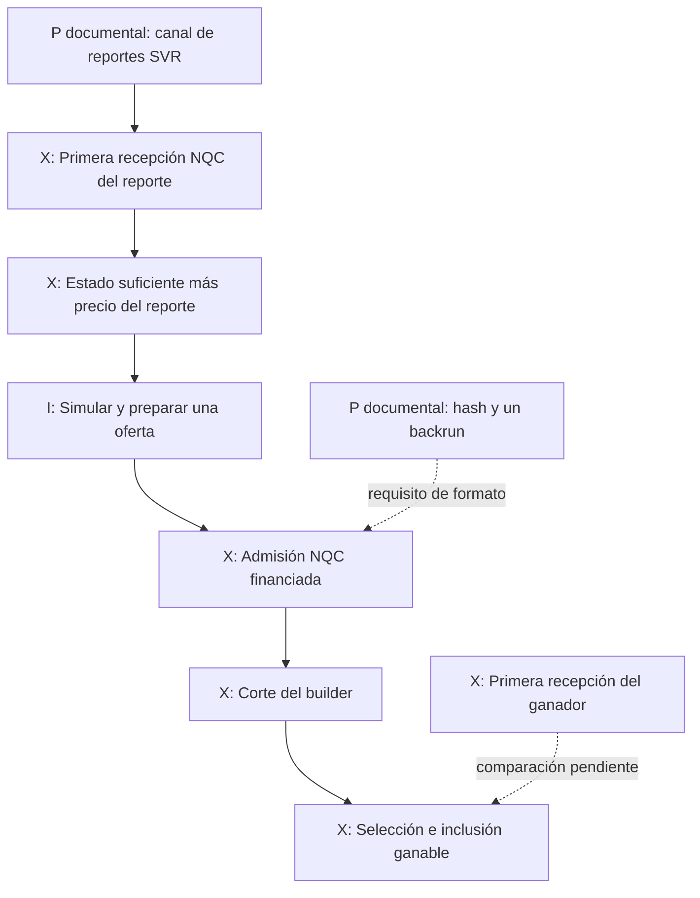
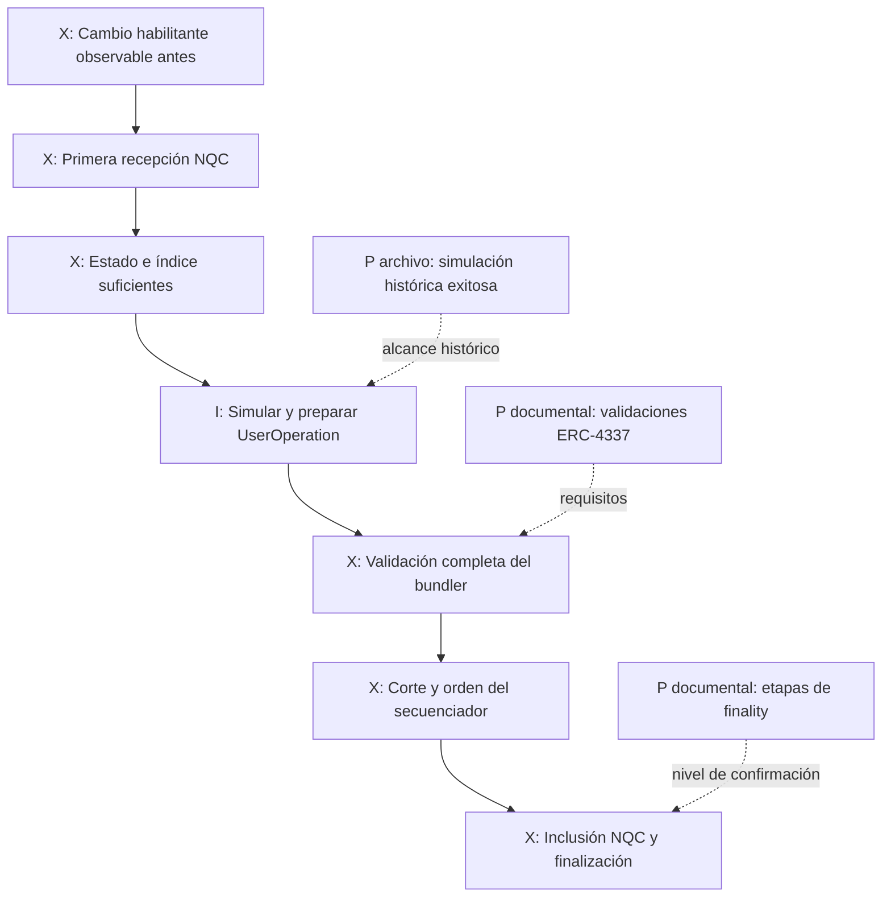
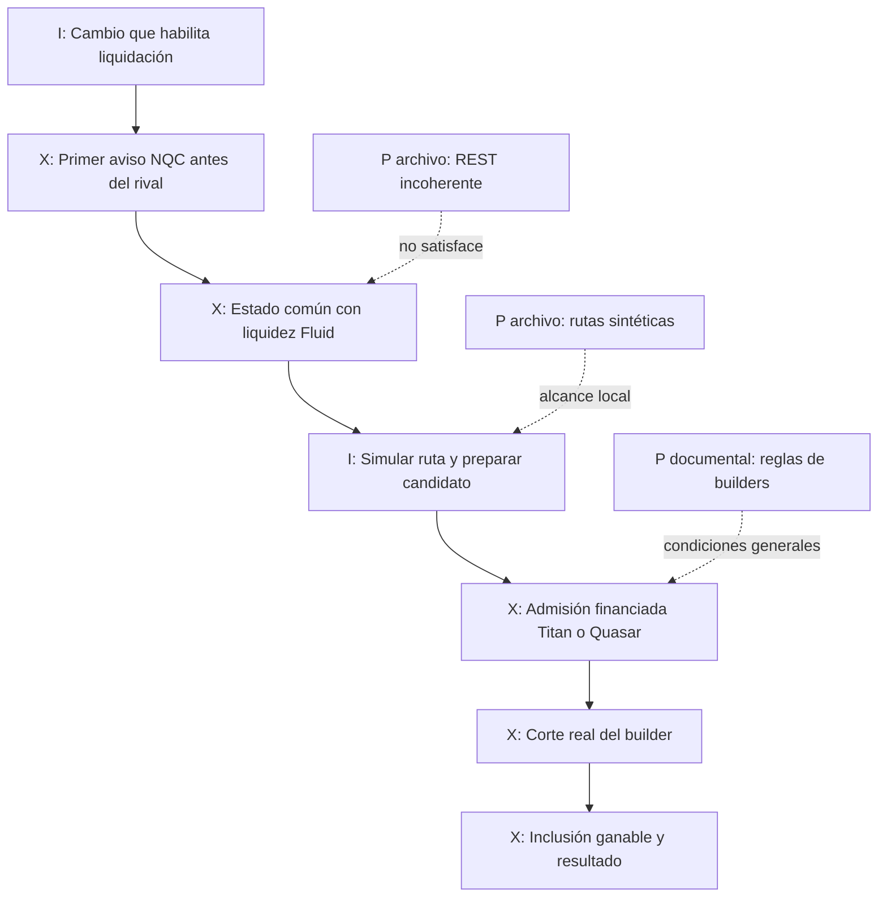

# NQC - Auditoría de temporalidad, admisión y competencia

**Directiva 002; 17 de octubre de 2026. Estado: TEMPORALIDAD_NO_DEMOSTRADA.**

## Dictamen

No existe en los expedientes examinados una prueba de que NQC recibiera la información suficiente antes que el competidor ganador y antes del cierre efectivo de admisión. Morpho conserva una muestra de estados incompatibles y un seguimiento que devolvió cero registros. Aave/SVR y Robinhood conservan resultados históricos de laboratorio y requisitos documentados; ninguno mide el acceso competitivo de NQC. [S-TM-001 a 005, S-TM-052 a 054]

La auditoría nueva rederiva los tiempos de Morpho desde las envolturas guardadas y distingue **hora de bloque, recepción de una respuesta, completitud de datos, validez de la operación y admisión real**. No ejecuta capturas onchain, firmas, bundles, nuevos forks ni procesos persistentes.

## 1. Alcance de la evidencia

Morpho se leyó en `0f26557c1f83e12efcf364ece6cebd8505d2e2c2`; Aave/SVR y Robinhood en documentos de viability `6693542e675f930a7ef0a4fd60cb72e7a6608845`. Los HEAD fueron fijados por el coordinador. El ledger `evidence/temporal_sources.json` contiene URLs, hashes, momentos de lectura y límites de procedencia; las capturas actuales de documentación pública no se presentan como reglas verificadas en el bloque histórico.

En los diagramas se usan exactamente tres clases:

- **P - Probado en su ámbito:** una regla aparece en documentación primaria o un dato aparece en el archivo identificado. La etiqueta precisa si es documental o un registro guardado. No significa prueba criptográfica de la cadena, financiación disponible o tiempo medido en producción.
- **I - Inferido/requerido:** relación causal necesaria o diseño propuesto; no fue observado como flujo NQC en vivo.
- **X - Inaccesible o no acreditado en el expediente:** falta dato, acceso probado o medición suficiente. X no demuestra imposibilidad universal ni inexistencia.

Las flechas continuas describen dependencias del camino requerido; las discontinuas conectan evidencia documental con un requisito. No representan llamadas ejecutadas durante esta auditoría.

## 2. Morpho: qué relojes realmente se guardaron

Todas las horas de esta sección son UTC del 17-oct-2026. Se recalcularon de los JSON; no se recuperaron observaciones perdidas de sesiones anteriores. [S-TM-043 a 050]

| Entrada | Altura reportada | Inicio local de solicitud | Respuesta recibida | Header recibido |
|---|---:|---|---|---|
| Mercado | 26210230 | 05:38:07.688398 | 05:38:10.802423 | 05:38:23.641087 |
| Posición | 26210231 | 05:38:10.802762 | 05:38:14.020207 | 05:38:26.670478 |
| Oráculo | 26210229 | 05:38:14.020622 | 05:38:17.557055 | 05:38:20.582801 |

La última respuesta necesaria llegó a **05:38:26.670478**, después de las tres respuestas de estado. Presentar los datos como completos a las 05:38:17.557055 adelantaría injustificadamente la disponibilidad de los headers. La corrección ya estaba aplicada en el informe final de Astra y esta auditoría la coteja independientemente. [S-TM-040, S-TM-044 a 049]

| Diferencia aritmética entre registros | Mercado | Posición | Oráculo |
|---|---:|---:|---:|
| Respuesta menos inicio local de solicitud | 3.114025 s | 3.217445 s | 3.536433 s |
| Recepción local menos timestamp de bloque | 11.802423 s | 3.020207 s | 30.557055 s |

La primera fila combina tránsito, servicio y cualquier otro trabajo entre esas marcas de reloj civil. No separa latencia de red. La segunda compara timestamp de bloque con reloj local: es un desfase descriptivo, **no una medición calibrada de retraso de publicación**. No se preservaron tiempos monotónicos, calibración de offset ni incertidumbre de sincronización. Tampoco existe hora de publicación del proveedor; el último instante de actualización del oráculo es nulo. No se asigna precisión física de microsegundos porque la cadena impresa tenga seis decimales.

El mercado, posición y oráculo pertenecen a tres alturas. Aun si coincidieran, la REST no incluye pruebas de estado contra las raíces de los headers. Las reglas de acumulación de interés de esos totales tampoco quedaron autenticadas. Por eso la muestra no permite clasificar liquidabilidad, salida Fluid o margen neto. El conjunto se rechaza por incoherencia; sus variables económicas continúan desconocidas. [S-TM-002, S-TM-040]

### El seguimiento de 95 segundos

La ventana consultada fue `[05:38:03, 05:39:38)`. El archivo de selección se guardó a **05:39:38.585742** y la solicitud comenzó a 05:39:38.586007. Esta selección es anterior a conocer la respuesta, pero **posterior al intervalo completo**. No es un prerregistro realizado antes de una ventana futura. Esta distinción se añade al reporte sin modificar el expediente original. [S-TM-041, S-TM-042]

Los datos completos de la muestra llegaron 23.670478 segundos después del inicio de esa ventana. Sólo quedaban 71.329522 segundos hasta su fin, incluso antes de considerar coherencia, simulación y admisión. No se puede acreditar una observación de 95 segundos con datos suficientes desde el principio.

El índice devolvió HTTP 200, cero items y `countTotal=0` a 05:39:42.727027. No hay evento posterior con el cual emparejar esta muestra y el retraso de indexación es desconocido. El resultado no demuestra que no hubo liquidaciones, no estima frecuencia y no proporciona una tasa de victoria de cero.

El intento separado de BlockPI devolvió HTTP 403/error 1010 en su primera lectura a 05:44:20.844574. Quedaron tres solicitudes planificadas sin ejecutar. Se respeta esa denegación; esta auditoría sólo leyó su envoltura guardada. No propone repetirla con otro cliente, identidad o cuenta. [S-TM-038, S-TM-039]

## 3. Caminos causales por arquitectura

### 3.1 Aave: candidato derivado de una ejecución histórica

El contrato de auditoría leído reporta 2273.989378 USDC después de flash/swap y antes de gas nativo/subasta; también reporta que la fuente original está fijada a bloques 26142067/68 y recibió ETH sintético en el laboratorio. Es un resultado mecánico histórico, no la primera recepción de una señal. La fuente concreta no se vuelve admisible hoy por observar una transacción ganadora del pasado. No se ejecutó ni alteró ese contrato. [S-TM-052]

**Prueba decisiva temporal:** un cambio habilitante identificado, su primera disponibilidad legítima y una adquisición NQC completa registrada antes del resultado, sobre una estrategia aplicable al estado de esa fecha. El antiguo bloque fijo es un rechazo explícito para promover esa fuente sin cambios; no es un rechazo matemático a toda liquidación Aave.

### 3.2 SVR Ethereum: señal documentada y subasta por demostrar

Chainlink documenta el canal SVR y la secuencia del hash de la actualización seguida de la transacción de liquidación firmada. Flashbots documenta la restricción de una transacción backrun para `mev_sendBundle`. Esos documentos describen una vía de participación; no acreditan acceso previo, oferta admisible ni aceptación para NQC. [S-TM-055, S-TM-056]

El expediente relacionó retrospectivamente otro reporte con una pista de archivo MEV-Share. Ese vínculo puede ayudar a identificar qué información existió; no fija cuándo la recibió NQC ni cuándo la obtuvo el ganador. Es necesario un registro prospectivo del mismo contenido, su contexto y la regla de corte aplicable. Los parámetros de bloque válido tampoco equivalen a la última hora a la que un builder aceptaría una oferta. [S-TM-052; inferencia de requisitos]

### 3.3 Robinhood L2: admisión completa y orden del secuenciador

La simulación positiva corresponde a bloque 66744162, índice 1, del 19-sep-2026. En el contexto del bloque anterior la posición resultó sana y la ruta fue rechazada. El expediente no aisló si el cambio se debió al tiempo, al estado o a actualizaciones del protocolo. Por tanto, no puede inventarse una señal previa a partir del cambio observado retrospectivamente. Los depósitos y saldos de fixtures fueron financiación sintética. [S-TM-053]

ERC-4337 exige validación al recibir una operación, al preparar un bundle y al validar el conjunto. La vigencia temporal de cuenta/paymaster, nonce, depósito agregado y reglas de reputación deben corresponder a la implementación examinada. Una ejecución `handleOps` de laboratorio no prueba esas etapas de admisión ni su duración. El documento actual del estándar es una referencia; debe fijarse la versión efectivamente usada. [S-TM-057]

Robinhood distingue confirmación del secuenciador, publicación en Ethereum y finalidad L1. Esta auditoría no aplica sus tiempos típicos a NQC ni interpreta una confirmación inicial como liquidación final irrevocable. [S-TM-059]

**Único gate de reapertura propuesto:** nueva evidencia revisable de un entorno de admisión identificado y una vía financiable sin recurso para el piloto acotado de esta ruta. Para afirmar fondos disponibles hacen falta condiciones aceptadas y fondos comprobados. El primer trabajo sería offline y debe conservar expiración, validación integral y aislamiento de envíos. La falta actual mantiene congelada esta línea; no se abre otro monitor ni se repite el fork. [S-TM-054]

### 3.4 Morpho Ethereum, callback/Bundler3 y builders

El callback puede reducir el requisito de caja del préstamo interno en el escenario local. Bundler3 tiene otros requisitos de liquidez. Ninguna propiedad crea información anterior, liquidez DEX o ETH para gas. El ensayo con Fluid histórico corresponde a una transacción de terceros. La verificación del orden sitúa B en índice 1 bajo el header fijado; no reconstruye los efectos de la transacción 0 ni suministra un estado previo auténtico. [S-TM-001, S-TM-004, S-TM-005]

Titan publica que sus algoritmos optimizan valor del bloque y que el orden no tiene garantía de top-of-block. Titan y Quasar publican parámetros de bloque/timestamp y secuencia de sustitución; no publican en las páginas leídas un cutoff exacto aplicable al candidato NQC. Quasar describe prioridad asociada a firma estable y reputación. Ninguna de estas reglas demuestra que NQC goce de dicha prioridad. [S-TM-060 a 063]

**No es válida la inferencia:** quitar el pago histórico a `block.coinbase` conserva automáticamente la misma inclusión. Cambiar la remuneración cambia una condición competitiva. La auditoría económica separada puede calcular el margen tolerable; esta auditoría temporal exige comprobar la admisión y el orden bajo esa remuneración concreta.

## 4. ¿Qué demostraría que NQC llegó antes?

Se necesitan cuatro cadenas de evidencia enlazadas al **mismo candidato y a la misma señal**:

1. El contenido exacto del trigger, su fuente y el momento desde el que era legítimamente accesible. Debe separarse la hora interna del reporte de la primera publicación externa.
2. Registro NQC de recepción y de completitud de todas las dependencias. Incluye headers, bloque/hash, posición, deuda/interés, oráculo, liquidez ejecutable y reglas de la oferta. No se rellena después con datos obtenidos del ganador.
3. Regla de admisión y reloj verificable del builder o secuenciador, más una constancia del momento en que recibió y admitió el candidato exacto. Un hash de respuesta, una simulación positiva y la inclusión son hechos diferentes.
4. Evidencia de cuándo el ganador recibió la misma información, por ejemplo un registro auditable de entrega y recepción. Deben delimitarse los canales cubiertos: sin cobertura de las vías pertinentes, el registro sólo prueba esa entrega y no la primera noticia recibida por cualquier canal. Su transacción pública o su posición final no revelan la primera recepción privada. Si esa información es inaccesible, la afirmación «antes que el ganador» queda desconocida, aunque NQC hubiera observado algo antes de publicarse el bloque.

Sean `I_N` e `I_W` los intervalos de primera recepción documentada de la misma señal, e `I_cut` el intervalo del cierre de admisión, todos con incertidumbre de reloj. Para afirmar orden estricto se exigiría `max(I_N) < min(I_W)`. Para acreditar margen de admisión, el acuse del candidato debe cumplir `max(I_admit) < min(I_cut)`. Si se solapan, o si un intervalo no tiene cota, no se afirma orden. No se presupone sincronización porque dos servicios impriman UTC.

Para la disponibilidad total se toma el máximo de los instantes de recepción de cada dependencia realmente utilizada. Simulación y preparación deben terminar después de contar con sus entradas. El camino crítico puede tener tareas paralelas, pero ninguna puede usar un dato futuro. Estar a tiempo es necesario; además hacen falta rentabilidad, financiación, validez y una oferta competitiva. La superioridad económica no se deduce del cronómetro.

## 5. Protocolo futuro read-only, finito y pre-registrado

**Diseño TEMP-READONLY-001. Estado: NO EJECUTADO.** Su objetivo es medir disponibilidad y coherencia de una muestra, sin afirmar de antemano que existe una liquidación. No es un bot operativo ni un monitor permanente.

### 5.1 Universo y presupuesto de observación

El primer ensayo propuesto mantiene un universo de un mercado y una posición, elegidos por identificador antes de conocer resultados:

| Campo | Valor o regla |
|---|---|
| Red | Ethereum, chainId 1 |
| Mercado | `0xa0534c78620867b7c8706e3b6df9e69a2bc67c783281b7a77e034ed75cee012e` |
| Posición | `0x018d6cc992eb576e2f36dc485b92d168ada37156` |
| Horizonte | Una ventana de 10 minutos con inicio y fin UTC fijados antes del inicio |
| Límite | Como máximo tres instantáneas y 30 solicitudes de lectura en total, o el límite menor permitido por las fuentes |
| Fuente de estado suficiente | **PENDIENTE de identificar y acreditar**; no usar proveedores/métodos previamente denegados |
| Selección de candidatos | Conservar todos los resultados del universo, sin filtro posterior por beneficio |
| Salida | Carpeta nueva con selección, entradas, errores, decisiones y manifest; terminación obligatoria al agotar tiempo/cupo |

El límite de 30 es una decisión de diseño, no una garantía de que baste para obtener un testigo completo. Si faltan estado, permiso o capacidad, se registra `FUENTE_INSUFICIENTE` y se cierra el ensayo. La selección no se promueve a prerregistro ejecutable hasta completar las URLs exactas, versiones, ventana futura, fuentes de reloj y reglas de finalidad. No se cambia el universo después de ver una respuesta desfavorable.

Para Aave/SVR o Robinhood haría falta un registro separado con su universo y acceso acreditado; este diseño no activa esas líneas ni supone un stream de señales disponible.

### 5.2 Relojes y evidencia por adquisición

Cada petición debe guardar hora civil UTC y reloj monotónico local de inicio/fin, identidad del proceso/sesión y evidencia disponible del offset e incertidumbre de sincronización. Se conservan por separado la hora declarada por el proveedor, la hora interna del reporte, la hora del bloque y la adquisición local. Si no se puede calibrar un reloj externo, su incertidumbre permanece sin cota.

Cada respuesta debe preservar bytes, URL, solicitud, estado HTTP/RPC, hora, bloque/hash reportados y SHA-256. Los campos ausentes, respuestas nulas, rechazos, censura y expiraciones se incluyen. La selección también debe estar fechada y hasheada **antes del comienzo de la ventana**, no sólo antes de leer el resultado.

Las duraciones de adquisición, preparación y simulación local se miden con el mismo reloj monotónico. No se descompone la duración HTTP en red/servicio sin instrumentación adicional. El análisis posterior conserva el contexto y los datos que estaban disponibles al momento de la decisión.

### 5.3 Coherencia, finalidad y tratamiento de resultados

Antes de evaluar una ruta se exige un mismo bloque/hash o un testigo intermedio justificado. Deben quedar resueltos prefijos relevantes, acumulación de intereses, fuente de oráculo y estado ejecutable de DEX. Una REST a igual altura puede seguir siendo sólo un dato de índice; su nivel de confianza se declara, no se eleva a prueba de storage.

La política debe separar cabeza observada, consenso/finalidad comprobada y, para una futura L2, confirmación del secuenciador, publicación L1 y finalidad L1. Si la fuente no permite verificar finalidad en el presupuesto, el campo queda desconocido. Un cambio de bloque o reorg invalida la asociación afectada y queda registrado; nunca se edita retroactivamente el bloque de una decisión.

Se registran como categorías distintas: trigger visto, respuesta incompleta, estado incoherente, candidato analizable, simulación local favorable/desfavorable, financiación desconocida y dato censurado. No hay firma ni entrega de ofertas. En consecuencia, una observación de este diseño puede mejorar las primeras etapas, pero **no puede certificar por sí sola admisión, inclusión ni prioridad frente al ganador**.

Los denominadores publicados serán universo seleccionado, solicitudes planificadas/ejecutadas, respuestas válidas/nulas/fallidas, instantáneas coherentes/incoherentes, candidatos con información suficiente y decisiones clasificables. Cuando no existan ofertas enviadas o perdidas, sus contadores se rotulan «no ejecutado», no una tasa de victoria del 0%.

### 5.4 Condiciones de parada y resultado decisivo

Se termina al alcanzar el límite de tiempo, peticiones o muestras, ante denegación/rate limit/error que requiera reintento no previsto, o al descubrir que una fuente no satisface el contexto declarado. No se cambia de identidad, suscripción o endpoint para superar un bloqueo. Se publica lo obtenido y lo que no se ejecutó.

El primer resultado útil sería una adquisición coherente con dependencias completas cuya disponibilidad local anteceda de forma verificable a un evento posterior del universo fijado. Eso resolvería una condición de orden. La comparación con el primer acceso del ganador y la admisión financiada seguiría requiriendo evidencia propia. Hasta entonces: **TEMPORALIDAD_NO_DEMOSTRADA**.

## Referencias principales

- [S-TM-002: observación Morpho, commit fijado](https://github.com/josuechavando350-png/nexus-quant-capital/blob/0f26557c1f83e12efcf364ece6cebd8505d2e2c2/migration/experiments/morpho-sponsored-gas/PROSPECTIVE_OBSERVATION.md).
- [S-TM-005: orden comprometido y prestate faltante](https://github.com/josuechavando350-png/nexus-quant-capital/blob/0f26557c1f83e12efcf364ece6cebd8505d2e2c2/migration/experiments/morpho-sponsored-gas/CASE_B_PRESTATE.md).
- [S-TM-052: contrato de auditoría SVR/Aave](https://github.com/josuechavando350-png/nexus-quant-capital/blob/6693542e675f930a7ef0a4fd60cb72e7a6608845/migration/engine-v2-20261015/source/ci/nqc-census/rmc-v2-shadow/SVR_EXECUTOR_AUCTION_CAPITAL_CONTRACT.md).
- [S-TM-053: replay Robinhood reportado](https://github.com/josuechavando350-png/nexus-quant-capital/blob/6693542e675f930a7ef0a4fd60cb72e7a6608845/migration/robinhood-real-state-replay-20261016/README.md).
- [S-TM-054: requisito de reapertura Robinhood](https://github.com/josuechavando350-png/nexus-quant-capital/blob/6693542e675f930a7ef0a4fd60cb72e7a6608845/migration/robinhood-viability-decision-20261016T1713/REOPENING.md).
- [S-TM-055: Chainlink SVR](https://docs.chain.link/data-feeds/svr-feeds/searcher-onboarding-ethereum); [S-TM-056: Flashbots RPC](https://docs.flashbots.net/flashbots-auction/advanced/rpc-endpoint).
- [S-TM-057: ERC-4337](https://eips.ethereum.org/EIPS/eip-4337); [S-TM-059: Robinhood finality](https://docs.robinhood.com/chain/transaction-finality/).
- [S-TM-060: Titan, orden del bloque](https://docs.titanbuilder.xyz/); [S-TM-061: Titan bundles](https://docs.titanbuilder.xyz/api/eth_sendbundle).
- [S-TM-062: Quasar bundles](https://docs.quasar.win/api/eth_sendbundle); [S-TM-063: Quasar autenticación](https://docs.quasar.win/authentication).

Las páginas web fueron revisadas como documentación actual, sin SHA de HTML canónico ni versión histórica demostrada. La primera apertura de Robinhood finality falló en la herramienta; se releyó correctamente la referencia previamente recuperada por el equipo. Ambas circunstancias se preservan en el ledger.
